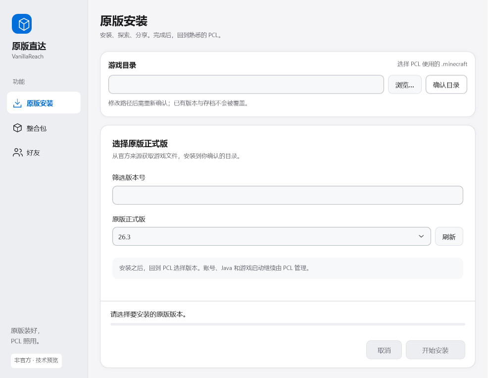
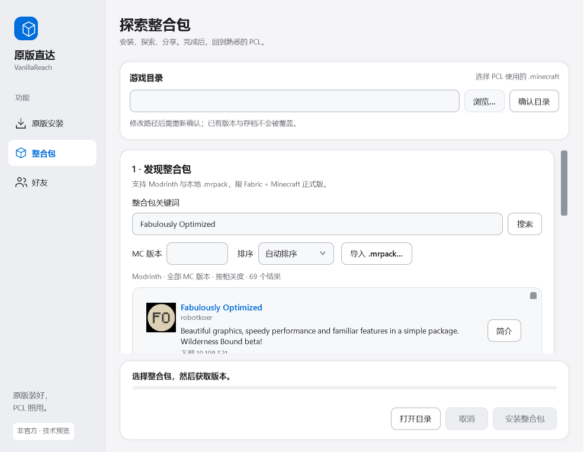

<div align="center">

# 原版直达 · VanillaReach

### 原版装好，PCL 照用。

**玩家不用换掉熟悉的 PCL，也不用接触命令行，就能完成原版安装。**

安装原版 · 探索 Fabric 整合包 · 分享指定版本

Windows 桌面应用 · 中文图形界面 · MIT 开源 · 非官方技术预览

[下载已发布预览版](https://github.com/qianmozhuoliunian/-pcl-vanilla-helper/releases/tag/v0.1.0-preview.1) · [当前源码运行方法](#开发与构建) · [反馈问题](https://github.com/qianmozhuoliunian/-pcl-vanilla-helper/issues) · [隐私说明](PRIVACY.md)

</div>



> **先看版本区别：** 上图及下文整合包、好友、新界面属于当前源码。现有下载版 **v0.1.0-preview.1 只有原版安装和旧界面**，不含这些新增功能。体验当前功能需按下方说明从源码构建；本次源码更新不代表发布了新的安装包。

原版直达是面向 Minecraft Java 玩家、配合 PCL 使用的独立安装助手。安装完成后回到 PCL，继续使用熟悉的账号、Java 和启动设置。本项目与 PCL、Mojang、Microsoft 均无隶属或认可关系。

## 少折腾安装，多留时间玩游戏

| 想做什么 | 当前源码能帮你做什么 |
| --- | --- |
| 给 PCL 安装原版 | 确认正在使用的游戏目录，选择原版正式版，查看下载与校验进度 |
| 找一个 Fabric 整合包 | 搜索 Modrinth，按 MC 版本筛选、排序、翻页，查看来源图标和发布者简介 |
| 安装下载好的整合包 | 导入本地 `.mrpack`，先检查内容与支持范围，再安装到新的独立实例 |
| 与朋友使用同一发布版本 | 配置可选好友服务后，经双方同意添加好友，分享固定项目、发布版本与归档校验值的卡片 |
| 保护已有游戏 | 原版同名版本不覆盖；共享文件哈希冲突就停止；整合包写入新实例 |

原版与整合包安装**无需登录原版直达账号**。好友是可选功能，当前没有已部署的公共好友服务器。

## 看得见的来源，选得明白的整合包



项目名称、图片和简介来自 **Modrinth 发布者的实际资料**；缺图、缺简介时明确提示。点击项目标题或“简介”查看介绍和来源链接，选择具体发布版本后再检查、安装。

当前支持 **Fabric + Minecraft Java 原版正式版**的整合包。Forge、NeoForge、Quilt 整合包尚不支持；并非所有 `.mrpack` 都符合当前安装规则。

图中以 [Fabulously Optimized](https://modrinth.com/modpack/fabulously-optimized) 的公开资料演示检索；图标与介绍属于原发布者，截图不表示其认可本工具，也不表示已验证该包全部版本。[截图来源与说明](docs/images/README.md)

[整合包使用说明](docs/modpack-discovery.md) · [好友配置与本机测试](docs/friends-setup.md)

## 三步安装原版

1. **确认目录。** 在 PCL 中确认正在使用的 `.minecraft`，在原版直达中选择它并点击“确认目录”。建议路径只供参考。
2. **选择版本。** 搜索或选择一个原版正式版，点击“开始安装”，等待下载与校验完成。
3. **回到 PCL。** 刷新或重新进入版本列表，选择新装版本。账号登录、Java 和游戏启动继续由 PCL 管理。

窗口加载或点击“刷新”时会获取官方正式版清单。新版本出现在清单中，不等于已经逐个验证兼容；安装仍需符合工具支持的元数据与文件规则。

安装期间避免其他程序修改同一个目录，不要安装到正在运行的游戏实例中。使用整合包时，先完成预检，再确认新实例与最终安装；已有存档、模组与配置不会被当作升级目标。

## 下载与版本状态

| 版本 | 内容 | 获取方式 |
| --- | --- | --- |
| 已发布 `v0.1.0-preview.1` | 原版正式版安装、旧版界面 | [Windows x64 ZIP，约 61 MB](https://github.com/qianmozhuoliunian/-pcl-vanilla-helper/releases/download/v0.1.0-preview.1/VanillaReach-win-x64-preview.zip) |
| 当前源码 | 原版安装、Fabric 整合包检索与导入、可选好友、更新后的桌面界面 | 按下方步骤构建 |

已发布 ZIP 请**完整解压，再双击 `VanillaReach.exe`**，保留随包说明与许可文件。[发布说明与 SHA-256](https://github.com/qianmozhuoliunian/-pcl-vanilla-helper/releases/tag/v0.1.0-preview.1)

面向 Windows 10/11 x64，需要能够访问实际下载来源。自包含程序无需另装 .NET SDK；从源码构建需要 SDK。当前仍是技术预览，干净 Windows、多设备体验和实际进入游戏尚未完成全面验证。

## 当前边界

- 原版使用 Minecraft/Mojang 官方源；整合包使用 Modrinth、Fabric 与官方游戏来源。**没有镜像加速，不承诺国内满速。**
- 不提供游戏启动、Minecraft 账号登录、Java 管理、基岩版、快照版、模组自动更新、回滚或整合包升级。
- 好友功能需要独立服务，支持好友申请、同意、删除、拉黑和固定版本卡片；不提供聊天、游戏在线状态或直接联机。接收卡片不会自动安装。
- 安装成功不保证一定进入游戏，仍取决于 PCL、账号、Java、硬件和目标版本。
- 已存在同名版本时会停止，不是自动修复入口。取消或异常退出后，已提交的有效共享资源以及部分临时文件可能保留。

项目继续专注辅助安装，独立启动器方向暂缓。

## 文件与隐私

源码和程序包不附带 Minecraft 游戏本体、PCL 程序、账号或存档。游戏文件由电脑向允许的来源直接请求，安装请求不通过好友服务中转。

应用没有广告、使用统计或崩溃自动上传功能，不读取 PCL 登录凭据或浏览器密码。使用可选好友功能时，邮箱、昵称及账号认证信息会发送给你配置的好友服务；记住登录使用 Windows 当前用户保护机制保存会话，不保存密码。联网服务仍可处理 IP 和必要请求信息。

[完整隐私说明](PRIVACY.md) · [本次公开前检查](docs/verification/2026-10-24-publication-review.md)

反馈截图或错误时，请遮住个人账号、私人路径、服务器地址及令牌，不要上传整个游戏目录、好友数据库、测试收件箱或账号配置。

## 开发与构建

需要 Windows 和 [.NET 10 SDK](https://dotnet.microsoft.com/download/dotnet/10.0)。在仓库根目录运行：

```powershell
dotnet test PclVersionBridge.sln --configuration Release
dotnet run --project src/PclVersionBridge.App/PclVersionBridge.App.csproj --configuration Release
```

构建可独立运行的 Windows x64 程序：

```powershell
dotnet publish src/PclVersionBridge.App/PclVersionBridge.App.csproj -c Release -r win-x64 --self-contained true -p:PublishSingleFile=true -p:IncludeNativeLibrariesForSelfExtract=true -p:PublishTrimmed=false -p:DebugType=None -p:DebugSymbols=false -p:RuntimeFrameworkVersion=10.0.13 -o .artifacts/vanillareach-win-x64
```

入口为 `.artifacts/vanillareach-win-x64/VanillaReach.exe`。分发时打包**整个输出目录**，保留许可、隐私说明和依赖声明。内部解决方案与命名空间暂保留 `PclVersionBridge`。

补充界面和好友集成检查：

```powershell
dotnet run --project tests/PclVersionBridge.UiChecks --configuration Release
dotnet run --project tests/VanillaReach.Friends.IntegrationChecks --configuration Release
```

好友服务的开发配置和本机测试包构建方法见 [friends-setup.md](docs/friends-setup.md)。本机测试包不等于已上线的公网好友服务。

[原版安装验证](docs/verification/mvp-results.md) · [整合包检索验证](docs/verification/modpack-discovery-results.md) · [界面验证](docs/verification/desktop-polish-results.md) · [好友验证](docs/verification/friends-results.md)

## 开源与贡献

自行编写的代码与文档采用 **[MIT License](LICENSE)**，第三方组件、项目图标和品牌分别遵循各自权利与许可。工具开源免费不改变 Minecraft 的游戏授权与账号要求。

感谢 [CmlLib.Core](https://github.com/CmlLib/CmlLib.Core) 提供安装基础能力，以及 [Modrinth](https://modrinth.com/) 和 [Fabric](https://fabricmc.net/) 提供的生态服务。

欢迎提供具体复现步骤、使用反馈与小范围改进。[提交 Issue](https://github.com/qianmozhuoliunian/-pcl-vanilla-helper/issues) · [第三方声明](THIRD-PARTY-NOTICES.md) · [依赖清单](docs/dependencies.md)
